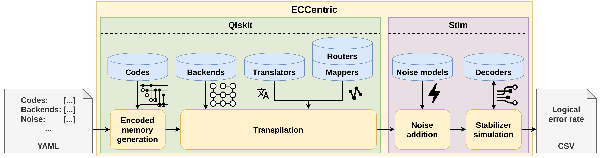
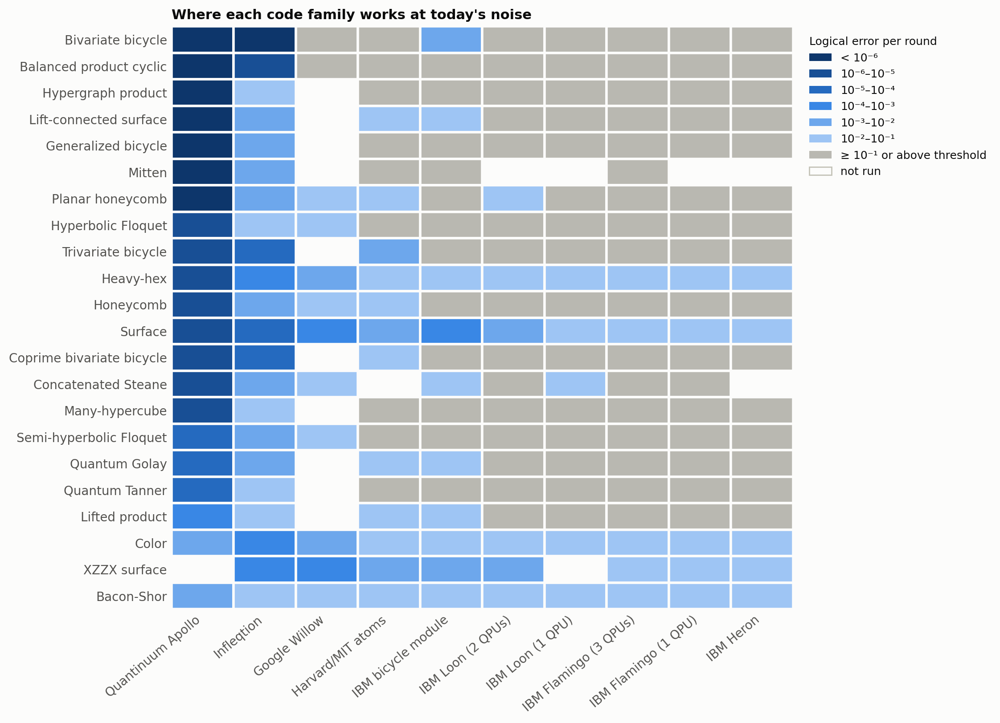
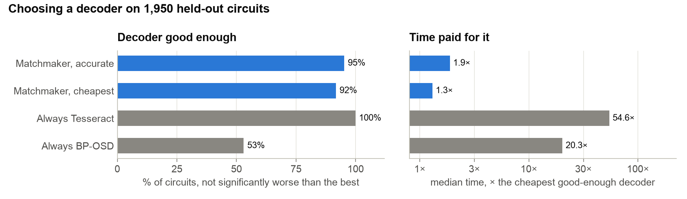

# ECCentric

[](https://doi.org/10.1145/3805635)
[](https://github.com/TUM-DSE/eccentric/actions/workflows/tests.yml)

[](LICENSE)
[](https://eccentric-benchmark.github.io)

**ECCentric is a benchmark for quantum error correction codes under realistic hardware conditions.** It
compiles a code's syndrome-extraction circuit onto a device, applies the device's noise, and decodes it, so
codes, devices, noise models and decoders can be compared end to end, and it comes with a large open dataset
of results.

<div align="center">

![codes][stat-codes] ![devices][stat-devices] ![noise models][stat-noise-models] ![decoders][stat-decoders]<br>
![results][stat-results] ![shots decoded][stat-shots-decoded] ![CPU hours][stat-cpu-hours]

</div>

<div align="center">

[](https://eccentric-benchmark.github.io)

**[Findings](https://eccentric-benchmark.github.io/results/findings.html)** ·
**[Results explorer](https://eccentric-benchmark.github.io/results/explorer.html)** ·
**[Codes](https://eccentric-benchmark.github.io/results/codes.html)** ·
**[Devices](https://eccentric-benchmark.github.io/results/devices.html)**

</div>

> 📄 **ECCentric: An Empirical Analysis of Quantum Error Correction Codes**, ACM SIGMETRICS 2026
> ([doi:10.1145/3805635](https://dl.acm.org/doi/abs/10.1145/3805635)). The version evaluated in the paper is tagged
> [`v1.0.0-sigmetrics26`](https://github.com/TUM-DSE/eccentric/tree/v1.0.0-sigmetrics26); `main` keeps growing
> and refining the benchmark, so its numbers can differ ([CHANGELOG](CHANGELOG.md)).

## What it covers



| Stage | What ECCentric includes |
| --- | --- |
| **Codes** ([list](docs/codes.md)) | Surface, color, heavy-hex, Bacon-Shor, concatenated Steane · bivariate, trivariate, coprime and generalized bicycle · balanced, lifted and hypergraph product · lift-connected surface, quantum Tanner, many-hypercube, Mitten, Golay, Reed-Muller · honeycomb and hyperbolic Floquet · XZZX, toric, repetition |
| **Operations** | Memory in the Z and X basis · lattice surgery (tqec) · fault-tolerant measurements, joint measurements and transversal CNOT on CSS codes |
| **Devices** ([list](docs/devices.md)) | IBM Heron, Flamingo, Loon and the bicycle module · Google Willow · Quantinuum Apollo · Infleqtion · Harvard/MIT atoms · multi-QPU devices with remote gates · synthetic topologies · code-native layouts |
| **Compilation** | Qiskit layout and routing · gate-set translation with Qiskit, BQSKit or TKET |
| **Noise** ([list](docs/noise-models.md)) | Circuit-level models (SD6, SI1000, ...) · hardware models with gate, readout, idle, leakage and atom-loss errors · erasure · scaling of any hardware model |
| **Decoders** ([list](docs/decoders.md)) | MWPM and correlated MWPM · BP-OSD, BP-LSD, BeliefFind, Relay-BP · Tesseract · MWPF · Chromobius · union-find · GARI and GARI++ · level-by-level BP-OSD · GPU versions of the BP-based decoders |
| **Tools** | [QEC Matchmaker](tools/matchmaker): predicts a circuit's logical error rate and decoding times and picks a decoder, without decoding |
| **Extensible** ([plugins](docs/plugins.md)) | Codes, decoders, devices, noise models and tools from other packages, without changing ECCentric |

## Results at a glance

<p align="center"></p>

- **Trapped ions protect the most code families:** at today's noise, 19 families get below 10⁻³ per round on
  Quantinuum Apollo, none on IBM Heron.
- **Routing, not the code, sinks qLDPC codes on IBM devices:** bivariate bicycle codes are 42× to 228,000× worse
  routed than on their native layout ([figure](site/figures/routing-vs-native.png)).
- **The surface code is below threshold on 6 of 8 device models today, the color code on 3**
  ([figure](site/figures/below-threshold.png)).
- **Z-basis memory flatters codes:** 72% of configurations are worse in the X basis ([figure](site/figures/x-vs-z.png)).
- **BP-OSD, the go-to qLDPC decoder, matches the best decoder on only 39% of configurations**
  ([figure](site/figures/decoders.png)).

All findings, with their data: **[on the website](https://eccentric-benchmark.github.io/results/findings.html)**
and in [`analysis/`](analysis/README.md).

## QEC Matchmaker: pick a decoder before you decode

<p align="center"></p>

**[Matchmaker](tools/matchmaker)** is trained on ECCentric's dataset. Given a noisy circuit, it predicts in
seconds, without decoding a single shot, whether the circuit is above threshold, its logical error rate, each
decoder's time per shot, and which decoder to use:

```bash
pip install -e tools/matchmaker
eccentric matchmaker advise circuit.stim --distance 5      # or: qec-matchmaker advise ...
```

On codes it never saw in training, it gets the threshold regime right for 97% of circuits, and its decoder
choice is good enough for 97% at a fraction of always running the most accurate decoder. Replaying ECCentric's
whole sweep, it reaches the quality of always running Tesseract at 54% of its CPU time. With `--gpu`, it also
plans for ECCentric's GPU decoders.

## Installation

Linux, Python 3.11:

```bash
git clone --recurse-submodules https://github.com/TUM-DSE/eccentric.git && cd eccentric
python3.11 -m venv venv && source venv/bin/activate
pip install -e .
(cd external/qiskit_qec && python setup.py build_ext --inplace)   # with CMake 4: CMAKE_POLICY_VERSION_MINIMUM=3.5 python setup.py ...
```

Optional: the GARI decoders need a C compiler with OpenMP; the GPU decoders an NVIDIA GPU and
`pip install --no-deps -r requirements-gpu.txt`.

## Quick start

```bash
eccentric configs/example.yaml        # writes experiment_results/Example/results.csv
```

An experiment is a YAML file; every list is swept, in parallel:

```yaml
experiments:
  - name: "Example"
    num_samples: 1000
    backends: ["custom_grid"]
    backends_sizes: [300]
    codes: ["surface", "color"]
    error_types: ["modsi1000"]
    error_probabilities: [0.002]
    decoders: ["bposd"]
```

More in the **[documentation](docs/README.md)**: configuration and command line, the dataset, plugins,
reproducing the paper (including Docker), and the repository layout.

## Citation

```bibtex
@inproceedings{swierkowska2026eccentric,
  title     = {ECCentric: An Empirical Analysis of Quantum Error Correction Codes},
  author    = {{\'S}wierkowska, Aleksandra and Pflieger, Jannik and Giortamis, Emmanouil and Bhatotia, Pramod},
  booktitle = {Proceedings of the ACM SIGMETRICS Conference (SIGMETRICS'26)},
  year      = {2026},
  doi       = {10.1145/3805635}
}
```

## License

[Apache License 2.0](LICENSE). Vendored and submodule code keeps its own license.

<!-- Badges: numbers read from experiment_results/Sweep/stats.json on main (python -m sweep.stats) -->
[stat-codes]: https://img.shields.io/badge/dynamic/json?url=https%3A%2F%2Fraw.githubusercontent.com%2FTUM-DSE%2Feccentric%2Fmain%2Fexperiment_results%2FSweep%2Fstats.json&query=%24.codes&label=codes&style=for-the-badge&color=2b6cb0
[stat-devices]: https://img.shields.io/badge/dynamic/json?url=https%3A%2F%2Fraw.githubusercontent.com%2FTUM-DSE%2Feccentric%2Fmain%2Fexperiment_results%2FSweep%2Fstats.json&query=%24.devices&label=devices&style=for-the-badge&color=2b6cb0
[stat-noise-models]: https://img.shields.io/badge/dynamic/json?url=https%3A%2F%2Fraw.githubusercontent.com%2FTUM-DSE%2Feccentric%2Fmain%2Fexperiment_results%2FSweep%2Fstats.json&query=%24.noise_models&label=noise%20models&style=for-the-badge&color=2b6cb0
[stat-decoders]: https://img.shields.io/badge/dynamic/json?url=https%3A%2F%2Fraw.githubusercontent.com%2FTUM-DSE%2Feccentric%2Fmain%2Fexperiment_results%2FSweep%2Fstats.json&query=%24.decoders&label=decoders&style=for-the-badge&color=2b6cb0
[stat-results]: https://img.shields.io/badge/dynamic/json?url=https%3A%2F%2Fraw.githubusercontent.com%2FTUM-DSE%2Feccentric%2Fmain%2Fexperiment_results%2FSweep%2Fstats.json&query=%24.display.results&label=results&style=for-the-badge&color=2f855a
[stat-shots-decoded]: https://img.shields.io/badge/dynamic/json?url=https%3A%2F%2Fraw.githubusercontent.com%2FTUM-DSE%2Feccentric%2Fmain%2Fexperiment_results%2FSweep%2Fstats.json&query=%24.display.shots&label=shots%20decoded&style=for-the-badge&color=2f855a
[stat-cpu-hours]: https://img.shields.io/badge/dynamic/json?url=https%3A%2F%2Fraw.githubusercontent.com%2FTUM-DSE%2Feccentric%2Fmain%2Fexperiment_results%2FSweep%2Fstats.json&query=%24.display.cpu_hours&label=CPU%20hours&style=for-the-badge&color=2f855a
