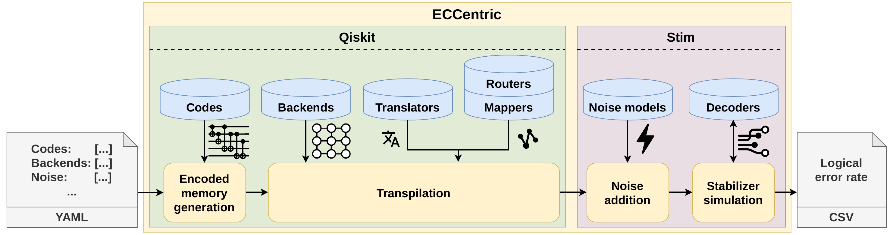

# ECCentric Bench

ECCentric is a benchmarking framework for evaluating Quantum Error Correction (QEC) codes under realistic hardware conditions: device topologies, connectivity, noise models, routing, gate translation, and decoders.

> 📄 **Paper:** <ins>**ECCentric: An Empirical Analysis of Quantum Error Correction Codes**</ins>, accepted at <ins>**ACM SIGMETRICS 2026 (SIGMETRICS'26)**</ins>.
> Aleksandra Świerkowska, Jannik Pflieger, Emmanouil Giortamis, Pramod Bhatotia.
> [arXiv:2511.01062 (PDF)](https://arxiv.org/pdf/2511.01062)

## Overview



An experiment is described in a YAML file listing the codes, backends, noise models and other parameters to sweep. For every combination, ECCentric generates the encoded memory circuit of the code and transpiles it with Qiskit onto the backend, applying gate translation, qubit mapping and routing. Stim then adds the noise model, simulates the stabilizer circuit and decodes the measurements. The resulting logical error rates are written to a CSV file. ([PDF version of the figure](docs/pipeline.pdf))

## Repository layout

```
eccentric/                 the framework (Python package)
├── __main__.py            command-line entry point: python -m eccentric
├── runner.py              config loading, parameter sweeps, parallel execution, result saving
├── experiments/           experiment types, one module each
├── backends/              fake hardware backends and custom topologies
├── codes/                 QEC code circuits: surface, heavy-hex, gross, color, Bacon-Shor, concatenated Steane,
│                          and the catalog of further codes (see "Codes")
├── noise/                 artificial and hardware-inspired noise models
├── decoders/              MWPM, BP-OSD and Chromobius
├── transpilers/           layout/routing and gate-set translation (Qiskit, BQSKit, TKET)
├── metrics/               gate and resource counting
├── plots/                 paper figures: python -m eccentric.plots
└── hardware/              comparison against real IBM hardware
configs/                   YAML configurations of all paper experiments, plus example.yaml
experiment_results/        raw results used in the paper
figures/                   generated figures
docs/                      pipeline overview figure
tests/                     unit and end-to-end tests
external/                  submodules: qiskit-qec fork, more-bacon-less-threshold, honeycomb_threshold, honeycomb-boundaries
```

## Installation (Linux)

Python 3.11 is recommended.

```bash
git clone --recurse-submodules https://github.com/TUM-DSE/eccentric.git
cd eccentric

python3.11 -m venv venv
source venv/bin/activate
pip install -e .

cd external/qiskit_qec
python setup.py build_ext --inplace
cd ../..
```

`pip install -e .` installs the dependencies from `requirements.txt` and adds an `eccentric` command, equivalent to `python -m eccentric`. If you cloned without `--recurse-submodules`, fetch the submodules first with `git submodule update --init --recursive`.

Run all commands from the repository root: results are written to `experiment_results/` and figures to `figures/` relative to the current directory.

## Quick start

```bash
python -m eccentric configs/example.yaml
```

This runs the small example in [`configs/example.yaml`](configs/example.yaml) and writes to `experiment_results/Example/`:

- `results.csv`: one row per configuration, for example the `logical_error_rate`
- `experiment.log`: completed, skipped and failed configurations, with error messages
- `metadata_<timestamp>.json`: a copy of the experiment configuration

Results are appended to `results.csv`, so delete the directory or rename the experiment before re-running it.

Command-line options:

| Option | Description |
| --- | --- |
| `python -m eccentric a.yaml b.yaml` | Run several configuration files in sequence |
| `-j N`, `--workers N` | Number of parallel worker processes (default: all CPUs). Lower it if you run out of memory |
| `-e NAME`, `--experiment NAME` | Only run the experiment called `NAME` (repeatable) |

## Configuration

Experiments are described in a YAML file containing a list under `experiments`. Every list-valued field is a sweep: the runner executes the Cartesian product of all lists, in parallel.

```yaml
experiments:
  - name: "Example"
    type: logical_error
    num_samples: 1000
    backends: ["custom_grid"]
    backends_sizes: [300]
    codes: ["surface", "color"]
    error_types: ["modsi1000"]
    error_probabilities: [0.002]
    decoders: ["bposd"]
```

### Fields

| Field | Description |
| --- | --- |
| `name` | Experiment name; results go to `experiment_results/<name>/` |
| `type` | Experiment type: `logical_error` (default), `decoder`, `program_stats`, `accumulated_error`, `chromobius`, `routing`, `translation` |
| `num_samples` | Number of shots (or, for `routing` and `translation`, number of repetitions) |
| `backends` | List of backends (see below) |
| `codes` | List of codes: `surface`, `hh` (heavy-hex), `gross`, `color`, `bacon` (Bacon-Shor), `steane` (concatenated Steane), and the codes listed under [Codes](#codes) |
| `decoders` | List of decoders: `bposd`, `bposd_chk`, `bposd_batch`, `mwpm`, `chromobius` (color code only), `bplsd`, `union_find`, `belief_find`, `belief_matching`, `relay_bp`, `tesseract` (see [Decoders](#decoders)) |
| `error_types` | List of noise models (see below) |
| `error_probabilities` | Physical error rates `p` for the artificial noise models |
| `backends_sizes` | Number of qubits of a `custom_*` backend. The largest code distance that fits is used |
| `distances` | Fixed code distances. The backend size is set to the minimum needed by the code. **Cannot be combined with `backends_sizes`** |
| `cycles` | Number of syndrome-extraction rounds (a single integer ≥ 2). Defaults to the code distance |
| `layout_methods` | Qiskit layout methods, e.g. `trivial`, `dense`, `sabre` |
| `routing_methods` | Qiskit routing methods, e.g. `basic`, `sabre`, `stochastic`, `lookahead` |
| `translating_methods` | Gate translation: `qiskit`, `bqskit`, `tket` |
| `gate_sets` | Target gate sets for `translation`: `h2`, `ibm_heron` |
| `optimization_levels` | Translation optimization levels for `translation` (default `[0, 2, 3]`) |

If neither `backends_sizes` nor `distances` is given, the backend's own size is used and the largest code distance that fits is chosen. Configurations whose code does not fit (distance < 3) are skipped and logged.

### Codes

Besides the codes of the paper, these codes are available. They are registered in `eccentric/codes/catalog.py`, which builds a noiseless Stim memory circuit (Z basis) for each of them; the circuit then goes through the same transpilation, noise and decoding pipeline as every other code. Code families accept any distance from their minimum upwards; fixed instances only have their own distance, so use `backends_sizes` (or `distances` with exactly that value) for them. The qubit count includes the syndrome ancillas.

| Name | Code | Qubits | Source |
| --- | --- | --- | --- |
| `repetition` | Repetition code, distance `d ≥ 3` | 2d − 1 | Stim generator |
| `xzzx` | XZZX surface code (rotated surface code with a Hadamard on every other data qubit), `d ≥ 3` | 2d² − 1 | Stim generator |
| `toric` | Unrotated toric code [[2d², 2, d]] | 4d² | [qLDPC](https://github.com/qLDPCOrg/qLDPC) |
| `honeycomb` | Periodic honeycomb (Floquet) code, SD6 circuit, even `d ≥ 4` | 2.5 · d · 6⌈d/4⌉ | [honeycomb_threshold](https://github.com/Strilanc/honeycomb_threshold) |
| `planar_honeycomb` | Planar honeycomb code with boundaries, SD6 circuit, `d ≥ 3` | 68 at d = 3 | [honeycomb-boundaries](https://github.com/Strilanc/honeycomb-boundaries) |
| `bb54`, `bb72`, `bb90`, `bb98`, `bb108`, `bb162`, `bb180`, `bb288`, `bb756` | Bivariate bicycle codes [[54,8,6]], [[72,12,6]], [[90,8,10]], [[98,6,12]], [[108,8,10]], [[162,8,14]], [[180,8,16]], [[288,12,18]], [[756,16,≤34]], same circuit as `gross` | 2n | Bravyi et al., arXiv:2308.07915, and `BBCODE_DICT` |
| `bpc36`, `bpc54`, `bpc72`, `bpc90`, `bpc108`, `bpc126`, `bpc144`, `bpc162`, `bpc180` | Balanced product cyclic codes [[36,8,4]], [[54,8,4]], [[72,8,8]], [[90,8,10]], [[108,8,8]], [[126,8,10]], [[144,8,12]], [[162,8,12]], [[180,8,16]], cardinal schedule | 2n | [QUITS](https://github.com/mkangquantum/quits), arXiv:2411.03302 |
| `hgp225`, `hgp625`, `hgp900` | Hypergraph products of classical (3,4)-regular LDPC codes, [[225,9,6]], [[625,25,8]], [[900,36,10]], cardinal schedule | 441, 1225, 1764 | QUITS (matrices in `eccentric/codes/data/quits_hgp`) |
| `lcs15`, `lcs52`, `lcs65`, `lcs150`, `lcs175` | Lift-connected surface codes [[15,3,3]], [[52,4,4]], [[65,5,5]], [[150,6,6]], [[175,7,7]], zxcoloration schedule | 27, 100, 125, 294, 343 | QUITS, arXiv:2401.02911 |
| `qlp544` | Quasi-cyclic lifted product code [[544,80,≤12]], cardinal schedule | 1024 | QUITS, arXiv:2308.08648 |
| `mitten150` | Mitten code [[150,30,≤8]] over C5 × S3 (QUITS' demo instance, not the d = 10 code of the paper), Mitten schedule | 270 | QUITS, arXiv:2607.28795 |
| `gb46`, `gb48`, `gb126` | Generalized bicycle codes [[46,2,9]], [[48,6,8]], [[126,28,8]] | 2n | Panteleev & Kalachev, arXiv:1904.02703; circuit from qLDPC |
| `hgp_hamming` | Hypergraph product of two [7,4,3] Hamming codes, [[58,16,3]] | 100 | qLDPC |
| `rm15` | Punctured quantum Reed-Muller code [[15,1,3]] | 29 | qLDPC |
| `lp` | Lifted product (lift-connected surface) code [[39,3,3]] | 75 | qLDPC |
| `qt36`, `qt72` | Quantum Tanner codes [[36,8,3]], [[72,14,4]] on the dihedral group D4 | 68, 136 | qLDPC |
| `hyperbolic_floquet_60`, `_120`, `_160`, `_240`, `_256`, `_320` | Hyperbolic Floquet codes [[60,5,3]], [[120,8,3]], [[160,10,4]], [[240,8,4]], [[256,34,4]], [[320,18,5]] (pair measurements, no ancillas) | n | [hyperbolic-floquet-data](https://github.com/oscarhiggott/hyperbolic-floquet-data) |
| `semi_hyperbolic_floquet_64`, `_144`, `_256`, `_400`, `_576` | Semi-hyperbolic Floquet codes from the Bolza code, k = 4, d = 3/4/6/7/8 (a distance-scaling family) | n | hyperbolic-floquet-data |

Notes:

- Decoders: `bposd` works for all of them. `mwpm` works for `repetition`, `xzzx`, `toric`, `honeycomb`, `planar_honeycomb` and the (semi-)hyperbolic Floquet codes; the other codes are not matchable. `chromobius` needs color-annotated detector coordinates, which are lost when the circuit goes through Qiskit.
- `d` is the code distance. The syndrome-extraction circuits can have a lower circuit-level distance: `lp` (qLDPC's edge-coloring schedule), the `lcs*` codes and the honeycomb codes have circuit distance below `d`, and `bpc72` below 8.
- `cycles` sets the number of syndrome rounds. Floquet codes count one round as one X, Y and Z sub-round; the planar honeycomb code needs an even number of at least 4 rounds and the hyperbolic Floquet codes run `2 + 2⌈(cycles − 2)/2⌉` rounds.
- Distances verified by exact computation: `bb54`, `bb98`, `gb46`, `gb48`, `rm15`, `hgp_hamming`, `lp`, `lcs15`, `lcs52`, `qt36`, `qt72`, and `toric` at d = 3. The `hgp*`, other `lcs*`, `qlp544` and `mitten150` distances are upper bounds from QUITS' randomized estimator, which match the cited papers. The others are taken from the cited papers; for `bb756` the distance is an upper bound.
- `hgp625`, `hgp900` and `qlp544` take up to a minute to build; their tests only run with `pytest -m slow`.

### Decoders

| Value | Decoder | Works for |
| --- | --- | --- |
| `mwpm` | Minimum-weight perfect matching (PyMatching) | Matchable codes: surface, heavy-hex, Bacon-Shor, repetition, XZZX, toric, honeycomb, hyperbolic Floquet |
| `bposd`, `bposd_batch`, `bposd_chk` | BP + ordered statistics decoding (ldpc) | All codes |
| `chromobius` | Möbius color-code decoder | Color code, only in the `chromobius` experiment type: it needs color-annotated detector coordinates, which are lost when the circuit goes through Qiskit |
| `bplsd` | BP + localised statistics decoding (ldpc), same BP settings as `bposd` | All codes |
| `belief_find` | BP + union-find (ldpc), same BP settings as `bposd` | All codes |
| `union_find` | Weighted union-find (ldpc) | Topological codes; fails on qLDPC codes |
| `belief_matching` | BP followed by matching with the BP marginals as weights | Matchable codes, and codes whose errors decompose into matching edges |
| `relay_bp` | Relay-BP (IBM, arXiv:2506.01779) with the paper's parameters | All codes; built for bivariate bicycle codes |
| `tesseract` | Tesseract most-likely-error search decoder (Google) with its default configuration | All codes, but slow beyond a few hundred qubits; use as an accuracy reference on small instances |

### Backends

| Value | Description |
| --- | --- |
| `custom_line`, `custom_grid`, `custom_cube`, `custom_full`, `custom_heavyhex` | Synthetic topologies; require `backends_sizes` (or `distances`) |
| `real_flamingo`, `real_loon` | IBM Flamingo and IBM Loon/Nighthawk (multi-chip, with remote gates) |
| `real_flamingo_1_qpu`, `real_loon_1_qpu` | The same devices restricted to a single QPU |
| `real_torino` | IBM Torino (Qiskit fake backend) |
| `real_willow` | Google Willow |
| `real_apollo`, `real_nsapollo` | Quantinuum Apollo with and without shuttling |
| `real_infleqtion`, `real_nsinfleqtion` | Infleqtion with and without shuttling |
| `real_harvard` | Harvard/MIT reconfigurable neutral-atom array with 448 atoms (Bluvstein et al., Nature 649, 2025): grid neighbours interact in place, all other pairs after moving an atom |
| `variance_<level>_<scale>` | Flamingo-like device with T1/T2 variance `<level>` ∈ {`none`, `low`, `mid`, `high`} and coherence times scaled by `<scale>`, e.g. `variance_mid_10` |
| `ibm_<device>` | A real IBM device through `QiskitRuntimeService` (requires an IBM token) |

### Noise models (`error_types`)

| Value | Description |
| --- | --- |
| `sd6`, `pm3`, `em3_1`, `em3_2`, `si1000`, `modsi1000`, `constant` | Artificial noise models parameterised by `error_probabilities` |
| `real_willow`, `real_apollo`, `real_infleqtion`, `real_heron` | Hardware-inspired noise models |
| `real_willow_spec` | Willow with the gate and measurement errors of Google's Willow spec sheet (Dec 2024) instead of arXiv:2408.13687; the other parameters, which the spec sheet does not report, are shared with `real_willow`. Use with the `real_willow` backend |
| `real_harvard` | Harvard/MIT neutral atoms from arXiv:2506.20661: 0.1% single-qubit and 0.5% CZ error, 0.46% readout error, 0.25% atom loss per move, measured gate, readout and move durations, T2 = 1 s (T1 is not reported and set to T2) |
| `real_flamingo`, `real_flamingo_downscaled` | IBM Flamingo noise, and the same noise scaled down 10× |
| `variance` | Decoherence driven by the T1/T2 values of a `variance_*` backend |
| `variance_low`, `variance_mid`, `variance_high` | Readout error drawn from a log-normal distribution with increasing variance |

Hardware noise models must be paired with a matching backend, for example `real_infleqtion` with `real_infleqtion`.

## Reproducing the paper

Every experiment of the paper has a configuration in [`configs/`](configs):

| Configuration | Paper experiment |
| --- | --- |
| `configs/size.yaml` | Code size |
| `configs/connectivity.yaml` | Connectivity and real topologies |
| `configs/variance.yaml` | Variance of decoherence and readout errors |
| `configs/technologies.yaml` | Hardware technologies |
| `configs/dqc.yaml` | Distributed quantum computing |
| `configs/routing.yaml` | Routing overhead |
| `configs/translation.yaml` | Gate-set translation overhead |
| `configs/accumulated.yaml` | Accumulated error and thresholds |
| `configs/decoder.yaml` | Decoders |
| `configs/chromobius.yaml` | Chromobius decoder (appendix) |
| `configs/program_stats.yaml` | Time and memory of the benchmark |

```bash
python -m eccentric configs/size.yaml   # one experiment
bash run_experiments.sh                 # all experiments, then all plots
python -m eccentric.plots               # only regenerate the figures
```

The full suite takes a long time. The results used in the paper are already in `experiment_results/`, so `python -m eccentric.plots` regenerates the figures in `figures/` without re-running anything.

## Running with Docker

1. Fetch the submodules and build the image:

    ```bash
    git submodule update --init --recursive
    docker build -t eccentric .
    ```

2. Run all experiments and plots (this executes `run_experiments.sh`):

    ```bash
    docker run --name eccentric_run eccentric
    ```

3. Copy the results and plots out of the container, then remove it:

    ```bash
    docker cp eccentric_run:/app/experiment_results ./experiment_results_docker
    docker cp eccentric_run:/app/figures ./figures_docker
    docker rm eccentric_run
    ```

To run a single experiment instead, override the command, for example `docker run --rm eccentric python -m eccentric configs/example.yaml`.

## Comparison with real IBM hardware

`eccentric.hardware.ibm_submit` submits random circuits (2–7 qubits, depth 100, 10 circuits per width, 1000 shots each) to an IBM Quantum backend. `eccentric.hardware.ibm_demo` then compares the measured fidelities with noiseless simulation and the noise models in this repository.

```bash
python -m eccentric.hardware.ibm_submit submit            # submit the job (asks for confirmation; uses IBM credits)
python -m eccentric.hardware.ibm_submit results <job_id>  # download and store the results
python -m eccentric.hardware.ibm_demo [<job_id>]          # analyse and plot (defaults to the job used in the paper)
```

Job metadata and results are stored in `experiment_results/ibm_runs/`. These scripts need an IBM Quantum API token. Follow the [IBM Quantum setup guide](https://quantum.cloud.ibm.com/docs/en/guides/cloud-setup) to save it in your environment.

## Extending the framework

- **New experiment type:** add a module to `eccentric/experiments/` that defines `REQUIRED` (the required config fields) and `run(task)`, which returns a list of result rows (dicts), and register it in `EXPERIMENTS` in `eccentric/experiments/__init__.py`. `task` is an `eccentric.experiments.Task` holding a single point of the sweep. `eccentric/experiments/base.py` provides the shared steps: `load_backend`, `resolve_distance`, `resolve_cycles`, `noisy_circuit`, `result_row`. Raise `Skip` to skip a configuration.
- **New code, backend, noise model or decoder:** add it to the matching package and to its dispatcher (`get_code` in `eccentric/codes/utils.py`, `get_backend` in `eccentric/backends/utils.py`, `get_noise_model` in `eccentric/noise/utils.py`, `decode` in `eccentric/decoders/decode.py`). It then becomes available in every configuration under its new name.

Run the tests with `pytest`.

## Citation

```bibtex
@inproceedings{swierkowska2026eccentric,
  title     = {ECCentric: An Empirical Analysis of Quantum Error Correction Codes},
  author    = {{\'S}wierkowska, Aleksandra and Pflieger, Jannik and Giortamis, Emmanouil and Bhatotia, Pramod},
  booktitle = {Proceedings of the ACM SIGMETRICS Conference (SIGMETRICS'26)},
  year      = {2026},
  note      = {arXiv:2511.01062}
}
```
